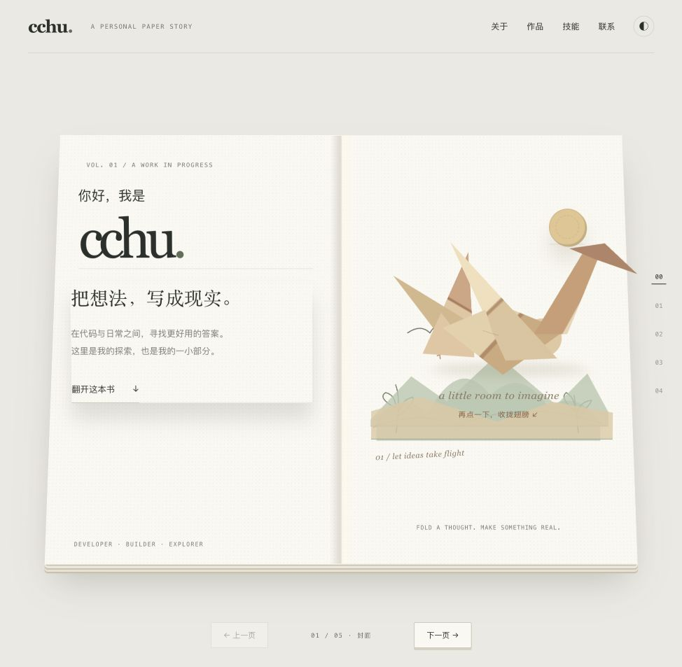

# cchu Paper Book

一个以 **Pop-up Book 立体纸艺书**为灵感的个人网站。使用原生 HTML、CSS 和 JavaScript，无框架、无第三方依赖、无需构建。

[在线体验](https://cchu-personal.amplefawn16.chatgpt.site/?v=6) · [作者 GitHub](https://github.com/carryhcc)



## 特性

- 共用书脊的连续双页书本，滚动驱动前后页翻转。
- 纸片沿折点折叠、抬升，并通过层叠、支撑折面和柔和投影体现景深。
- 手绘桌面、分层山景、折纸鹤、风车、手风琴折页与信封。
- 点击可展开／收拢纸鹤和折页、旋转风车、打开／合上信封。
- 封面、关于、作品、技能、联系五个章节，以及三个可点击详情页。
- 上一页／下一页、目录定位、米白／纯白纸色切换和邮箱复制。
- 手机端简化抬升效果；尊重系统的 `prefers-reduced-motion` 设置。

## 本地运行

安装 Python 3 后，在仓库根目录运行：

```sh
python3 -m http.server 4173 --directory dist
```

打开 <http://localhost:4173>。网站运行无需 Node.js；如已安装 Node.js，可以用下面的命令检查 JavaScript 语法：

```sh
node --check dist/app.js
```

## 目录

```text
dist/
  index.html          # 主页与纸艺插画
  styles.css          # 纸张、3D 折面、响应式布局
  app.js              # 滚动联动、翻页、折纸互动与邮箱复制
  tools.html          # 日常工具详情
  ai.html             # AI 工作流详情
  engineering.html    # 工程与性能详情
docs/
  preview.jpg         # 网站效果预览
```

## 修改与复用

个人介绍、联系方式和项目内容在 `dist/*.html` 中修改。纸张颜色和布局在 `dist/styles.css` 中调整。

`paper-piece` 元素的 `data-depth` 表示抬升深度；`data-hinge` 指定折点方向。`fold-toy` 元素通过 `data-fold` 选择纸鹤、折页、风车或信封交互。滚动进度与机关状态集中在 `dist/app.js` 中维护。

复用网站时请替换 cchu 的昵称、邮箱、GitHub 链接和个人介绍。页面内容为静态介绍，不依赖 API 或数据库。

## 静态部署

可直接将 `dist/` 上传到任意静态网站服务。若使用 GitHub Pages，可在 Pages 的发布工作流中将 `dist/` 作为站点目录上传；本仓库未自动启用部署或配置托管账号。

## 验证与兼容性

已检查 JavaScript 语法、静态链接、桌面折纸点击与 320px 窄屏布局。推荐使用支持 CSS 3D Transform 的现代浏览器。尚未覆盖全部手机真机和浏览器的 GPU 性能。

## 许可证

[MIT](LICENSE) © 2026 cchu。许可证覆盖本仓库代码及随附的原创 CSS／SVG 插画。
